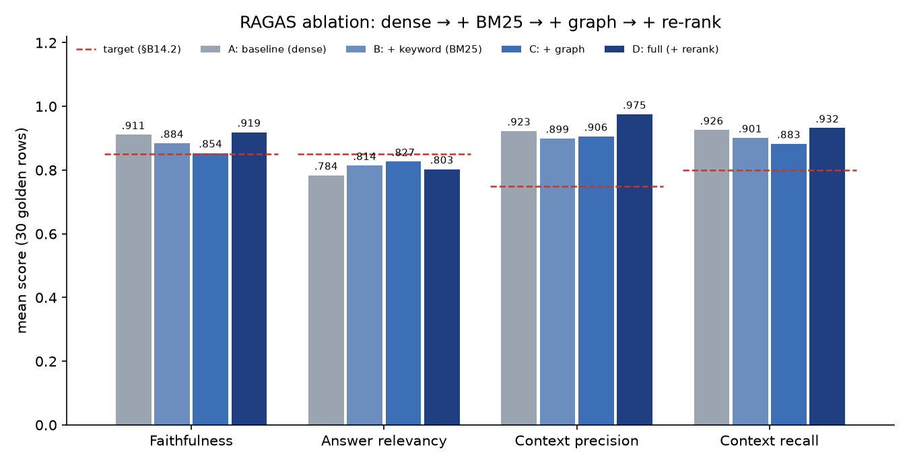

# RAGAS Evaluation Report

Phase 10: the four §B14.2 ablation configs on the 30-row golden set, run against the **complete system**
(LangGraph agent with all tools, guardrails, cache off). Phase 6's A vs D baseline, from before the agent
existed, is kept at the end for comparison.

| Config | Dense | BM25 | Graph retrieval | Re-rank |
|---|---|---|---|---|
| A: baseline | ✅ | | | |
| B: + keyword | ✅ | ✅ | | |
| C: + graph | ✅ | ✅ | ✅ | |
| D: full | ✅ | ✅ | ✅ | ✅ |

**How the numbers are produced.** `eval/ragas/run_ragas.py --config X` starts the API with the config's
`USE_*` flags (and `USE_CACHE=false`), sends every golden question to `POST /chat` in a fresh session, and
scores the answers with the RAGAS 0.4 metrics (judge gpt-4o-mini). `retrieved_contexts` are the answer's
**citation snippets** (§B14.2, D-012): a context counts only if the answer cites it. SQL citations carry the
query as well as the result (D-027). Rows RAGAS can't score as is are handled as in D-018: an answerable row
with no citations gets 0 context precision and recall; unanswerable rows are scored on abstention only.

**What the flags switch off.** `USE_BM25`, `USE_GRAPH` and `USE_RERANK` control the **retrieval pipeline**
(§B8): the context retrieved before the agent's first step and inside `search_knowledge_base`. They don't
remove agent tools. The agent can still call `query_graph` (graph templates) and `sql_query` in every
config. So this is an ablation of retrieval *within the agentic system*, not of the graph as a whole.
Finding 1 below explains why that matters.

The results are also in Langfuse: dataset **`eka-golden`** (30 items) with runs `ragas-A-2026-10-31` …
`ragas-D-2026-10-31`. Each item holds the answer, citations and API trace id, scored as `ragas_faithfulness`,
`ragas_answer_relevancy`, `ragas_context_precision`, `ragas_context_recall` and `abstained`
(`run_ragas.py --report-only --push-langfuse` replays the saved results; it makes no new /chat calls).

<!-- BEGIN GENERATED (run_ragas.py) -->

_Generated 2026-10-31 by `eval/ragas/run_ragas.py` from `ragas_A.json`, `ragas_B.json`, `ragas_C.json`, `ragas_D.json`. Golden set: 30 rows (`eval/datasets/golden.jsonl`). Evaluator `gpt-4o-mini`; answer relevancy embeddings `text-embedding-3-small`. Generator: the routed agent (§B12.2), answers per model in the last column._

### Overall

| Config | Run date | Faithfulness | Answer relevancy | Context precision | Context recall | Correct abstention (unanswerable) | False abstention (answerable) | p50 latency | /chat cost | Answered by |
|---|---|---|---|---|---|---|---|---|---|---|
| *Target (§B14.2)* | | *≥ 0.85* | *≥ 0.85* | *≥ 0.75* | *≥ 0.80* | | | | | |
| A: baseline (dense) | 2026-10-31 | 0.911 | 0.784 | 0.923 | 0.926 | 1.000 | 0.037 | 4821 ms | $0.2528 | gpt-4o 11, gpt-4o-mini 19 |
| B: + keyword (BM25) | 2026-10-31 | 0.884 | 0.814 | 0.899 | 0.901 | 1.000 | 0.000 | 4258 ms | $0.2607 | gpt-4o 11, gpt-4o-mini 19 |
| C: + graph | 2026-10-31 | 0.854 | 0.827 | 0.906 | 0.883 | 1.000 | 0.000 | 4171 ms | $0.1626 | gpt-4o 11, gpt-4o-mini 19 |
| D: full (+ rerank) | 2026-10-31 | 0.919 | 0.803 | 0.975 | 0.932 | 1.000 | 0.000 | 4856 ms | $0.1495 | gpt-4o 11, gpt-4o-mini 19 |

### By query type

Each cell lists the configs in order (A / B / C / D). Context metrics and answer relevancy are n/a for unanswerable rows, which are scored on abstention instead.

| Query type | n | Faithfulness | Answer relevancy | Context precision | Context recall | Abstained |
|---|---|---|---|---|---|---|
| factual | 10 | 0.800 / 0.811 / 0.855 / 0.877 | 0.782 / 0.854 / 0.844 / 0.862 | 1.000 / 1.000 / 1.000 / 1.000 | 0.867 / 0.883 / 0.883 / 0.883 | 0.100 / 0.000 / 0.000 / 0.000 |
| multi_hop | 8 | 0.950 / 0.887 / 0.792 / 0.881 | 0.619 / 0.632 / 0.692 / 0.594 | 0.740 / 0.786 / 0.807 / 0.917 | 0.917 / 1.000 / 0.875 / 0.917 | 0.000 / 0.000 / 0.000 / 0.000 |
| structured | 5 | 1.000 / 1.000 / 0.900 / 1.000 | 0.950 / 0.938 / 0.928 / 0.940 | 1.000 / 0.800 / 0.800 / 1.000 | 1.000 / 0.800 / 0.800 / 1.000 | 0.000 / 0.000 / 0.000 / 0.000 |
| faq | 4 | 1.000 / 0.917 / 0.917 / 1.000 | 0.909 / 0.926 / 0.926 / 0.903 | 1.000 / 1.000 / 1.000 / 1.000 | 1.000 / 0.875 / 1.000 / 1.000 | 0.000 / 0.000 / 0.000 / 0.000 |
| unanswerable | 3 | n/a / n/a / n/a / n/a | n/a / n/a / n/a / n/a | n/a / n/a / n/a / n/a | n/a / n/a / n/a / n/a | 1.000 / 1.000 / 1.000 / 1.000 |

**Phase 6 check: D ≥ A on multi-hop context recall: 0.917 vs 0.917 ✅**

### Per row

F = faithfulness, AR = answer relevancy, CP = context precision, CR = context recall, cit = number of citations, ✋ = abstained.

| # | Type | Question | A: F / AR / CP / CR (cit) | B: F / AR / CP / CR (cit) | C: F / AR / CP / CR (cit) | D: F / AR / CP / CR (cit) |
|---|---|---|---|---|---|---|
| 1 | factual | How long are audit logs in the Audit Log Store retained, and can th… | 1.000 / 0.881 / 1.000 / 1.000 (1) | 1.000 / 0.881 / 1.000 / 1.000 (1) | 1.000 / 0.881 / 1.000 / 1.000 (1) | 1.000 / 0.881 / 1.000 / 1.000 (1) |
| 2 | factual | What are the recovery time and recovery point objectives for the Le… | 1.000 / 0.840 / 1.000 / 1.000 (2) | 1.000 / 0.840 / 1.000 / 1.000 (2) | 1.000 / 0.840 / 1.000 / 1.000 (2) | 1.000 / 0.840 / 1.000 / 1.000 (2) |
| 3 | factual | How long does break-glass privileged access last, and where is it i… | 1.000 / 0.916 / 1.000 / 1.000 (1) | 0.750 / 0.916 / 1.000 / 1.000 (2) | 1.000 / 0.916 / 1.000 / 1.000 (2) | 1.000 / 0.916 / 1.000 / 1.000 (2) |
| 4 | factual | At what consumer lag should the Kafka Cluster alert fire? | 0.500 / 0.924 / 1.000 / 0.500 (2) | 0.500 / 0.924 / 1.000 / 0.500 (2) | 0.500 / 0.924 / 1.000 / 0.500 (2) | 1.000 / 0.924 / 1.000 / 0.500 (2) |
| 5 | factual | What are the steps for manual promotion during a Ledger DB failover? | 1.000 / 1.000 / 1.000 / 1.000 (1) | 1.000 / 1.000 / 1.000 / 1.000 (1) | 1.000 / 1.000 / 1.000 / 1.000 (1) | 0.909 / 1.000 / 1.000 / 1.000 (1) |
| 6 | factual | How quickly must an emergency secret rotation happen, and how long … | 0.500 / 0.548 / 1.000 / 0.667 (1) | 0.500 / 0.642 / 1.000 / 0.667 (1) | 0.750 / 0.671 / 1.000 / 0.667 (1) | 0.500 / 0.630 / 1.000 / 0.667 (1) |
| 7 | factual | How far ahead of expiry must API Gateway TLS certificates be renewed? | 1.000 / 0.894 / 1.000 / 1.000 (1) | 1.000 / 0.894 / 1.000 / 1.000 (1) | 1.000 / 0.894 / 1.000 / 1.000 (1) | 1.000 / 0.894 / 1.000 / 1.000 (1) |
| 8 | factual | Who has to approve a refund of more than $5,000? | 0.500 / 0.933 / 1.000 / 1.000 (1) | 0.500 / 0.933 / 1.000 / 1.000 (1) | 0.500 / 0.798 / 1.000 / 1.000 (1) | 0.500 / 0.933 / 1.000 / 1.000 (1) |
| 9 | factual | How quickly must we respond to a chargeback notice, and when does a… | 0.500 / 0.000 / 1.000 / 0.500 (1) ✋ | 1.000 / 0.629 / 1.000 / 0.667 (2) | 1.000 / 0.629 / 1.000 / 0.667 (2) | 1.000 / 0.715 / 1.000 / 0.667 (2) |
| 10 | factual | What caused the payment latency spike in INC-2025-031, and how long… | 1.000 / 0.884 / 1.000 / 1.000 (2) | 0.857 / 0.884 / 1.000 / 1.000 (2) | 0.800 / 0.884 / 1.000 / 1.000 (2) | 0.857 / 0.884 / 1.000 / 1.000 (3) |
| 11 | multi_hop | Who manages the team that owns the system covered by SOP-OPS-014 (D… | 1.000 / 0.549 / 0.583 / 1.000 (3) | 1.000 / 0.538 / 1.000 / 1.000 (1) | 1.000 / 0.441 / 0.333 / 1.000 (3) | 0.714 / 0.827 / 1.000 / 1.000 (3) |
| 12 | multi_hop | Which team owns the system that SOP-OPS-009 (Secrets Rotation) cove… | 1.000 / 0.746 / 0.500 / 1.000 (2) | 1.000 / 0.750 / 0.500 / 1.000 (2) | 0.750 / 0.650 / 0.500 / 1.000 (2) | 0.667 / 0.737 / 0.500 / 1.000 (2) |
| 13 | multi_hop | Who is the manager of the team that owns the system handled by SOP-… | 1.000 / 0.683 / 1.000 / 1.000 (1) | 0.500 / 0.794 / 1.000 / 1.000 (1) | 0.500 / 0.794 / 1.000 / 1.000 (1) | 1.000 / 0.692 / 1.000 / 1.000 (1) |
| 14 | multi_hop | Who manages the team that owns the system covered by SOP-SUP-003 (R… | 1.000 / 0.463 / 1.000 / 1.000 (3) | 1.000 / 0.414 / 1.000 / 1.000 (3) | 0.333 / 0.911 / 1.000 / 1.000 (1) | 1.000 / 0.428 / 1.000 / 1.000 (2) |
| 15 | multi_hop | SOP-SUP-008 (Chargeback Handling) requires a risk score from one of… | 0.667 / 0.670 / 1.000 / 0.333 (2) | 0.667 / 0.670 / 1.000 / 1.000 (3) | 1.000 / 0.453 / 1.000 / 1.000 (2) | 0.667 / 0.655 / 1.000 / 1.000 (2) |
| 16 | multi_hop | Which teams own the systems Payment Gateway depends on? | 0.933 / 0.843 / 0.000 / 1.000 (7) | 0.933 / 0.858 / 0.000 / 1.000 (7) | 1.000 / 0.880 / 0.625 / 1.000 (8) | 1.000 / 0.855 / 1.000 / 1.000 (8) |
| 17 | multi_hop | Which team owns the system affected by INC-2025-022 (the expired TL… | 1.000 / 0.557 / 1.000 / 1.000 (3) | 1.000 / 0.649 / 1.000 / 1.000 (3) | 0.750 / 0.557 / 1.000 / 1.000 (2) | 1.000 / 0.557 / 1.000 / 1.000 (2) |
| 18 | multi_hop | Which policies govern the systems affected by incident INC-2025-012? | 1.000 / 0.444 / 0.834 / 1.000 (9) | 1.000 / 0.377 / 0.786 / 1.000 (9) | 1.000 / 0.848 / 1.000 / 0.000 (2) | 1.000 / 0.000 / 0.833 / 0.333 (3) |
| 19 | structured | How many SEV1 tickets are there in total? | 1.000 / 0.984 / 1.000 / 1.000 (1) | 1.000 / 0.939 / 0.000 / 0.000 (1) | 0.500 / 0.874 / 0.000 / 0.000 (1) | 1.000 / 0.984 / 1.000 / 1.000 (1) |
| 20 | structured | How many support tickets currently have the status 'open'? | 1.000 / 0.933 / 1.000 / 1.000 (1) | 1.000 / 0.933 / 1.000 / 1.000 (1) | 1.000 / 0.933 / 1.000 / 1.000 (1) | 1.000 / 0.933 / 1.000 / 1.000 (1) |
| 21 | structured | Which system has the most SEV1 tickets, and how many does it have? | 1.000 / 0.905 / 1.000 / 1.000 (1) | 1.000 / 0.889 / 1.000 / 1.000 (1) | 1.000 / 0.905 / 1.000 / 1.000 (1) | 1.000 / 0.856 / 1.000 / 1.000 (1) |
| 22 | structured | How many transactions were recorded in the EMEA region? | 1.000 / 1.000 / 1.000 / 1.000 (1) | 1.000 / 1.000 / 1.000 / 1.000 (1) | 1.000 / 1.000 / 1.000 / 1.000 (1) | 1.000 / 1.000 / 1.000 / 1.000 (1) |
| 23 | structured | How many employees are on the Data-Platform team? | 1.000 / 0.929 / 1.000 / 1.000 (1) | 1.000 / 0.929 / 1.000 / 1.000 (1) | 1.000 / 0.929 / 1.000 / 1.000 (1) | 1.000 / 0.929 / 1.000 / 1.000 (1) |
| 24 | faq | What is the session timeout for the Customer Portal? | 1.000 / 1.000 / 1.000 / 1.000 (3) | 1.000 / 1.000 / 1.000 / 0.500 (1) | 1.000 / 1.000 / 1.000 / 1.000 (2) | 1.000 / 1.000 / 1.000 / 1.000 (3) |
| 25 | faq | Which currencies does Acme Pay support? | 1.000 / 0.969 / 1.000 / 1.000 (3) | 1.000 / 0.969 / 1.000 / 1.000 (3) | 1.000 / 0.969 / 1.000 / 1.000 (3) | 1.000 / 0.969 / 1.000 / 1.000 (3) |
| 26 | faq | How long does it take for a refund to reach my bank account? | 1.000 / 0.711 / 1.000 / 1.000 (2) | 0.667 / 0.779 / 1.000 / 1.000 (4) | 0.667 / 0.779 / 1.000 / 1.000 (4) | 1.000 / 0.686 / 1.000 / 1.000 (4) |
| 27 | faq | Does Acme store my full card number? | 1.000 / 0.956 / 1.000 / 1.000 (4) | 1.000 / 0.956 / 1.000 / 1.000 (5) | 1.000 / 0.956 / 1.000 / 1.000 (5) | 1.000 / 0.956 / 1.000 / 1.000 (4) |
| 28 | unanswerable | What is Acme's parental leave policy? | – / – / – / – (0) ✋ | – / – / – / – (0) ✋ | – / – / – / – (0) ✋ | – / – / – / – (0) ✋ |
| 29 | unanswerable | What is the daily per-diem limit for business travel expenses? | – / – / – / – (0) ✋ | – / – / – / – (0) ✋ | – / – / – / – (0) ✋ | – / – / – / – (0) ✋ |
| 30 | unanswerable | Which Kubernetes version does the Payment Gateway run on? | – / – / – / – (0) ✋ | – / – / – / – (0) ✋ | – / – / – / – (0) ✋ | – / – / – / – (0) ✋ |

Judge errors (scored n/a): A 0, B 0, C 0, D 0.

<!-- END GENERATED -->

## Interpretation

**Targets (§B14.2), config D:** faithfulness **0.919** ✅ (≥ 0.85), context precision **0.975** ✅ (≥ 0.75),
context recall **0.932** ✅ (≥ 0.80), answer relevancy **0.803** ❌ (≥ 0.85, gap explained in finding 4).
All 3 unanswerable questions abstain in every config, and no answerable row in B, C or D abstains.

**1. Once the agent exists, graph *retrieval* no longer decides multi-hop. The graph *tool* does.**
In Phase 6, without an agent, dense-only A abstained on all 8 multi-hop rows (context recall 0.000 vs D's
0.875). Now A reaches **0.917** multi-hop context recall, the same as D: every multi-hop answer in every
config cites `[Gn]` facts, which in A can only come from the agent calling `query_graph`. The agent recovers
from missing graph retrieval with one extra tool round, at a cost of time (A p50 4.8 s, similar to D's, since D
pays for re-ranking instead). The value of the graph is clearer in a system-level view: without the graph
there is no source for ownership or managers at all (D-009), and the Phase 6 run shows what happens then.
Removing the tool too would need a new flag; it wasn't built (no spec requirement, and Phase 6 already
measured it).

**2. Re-ranking is what lifts precision and faithfulness.** D vs C: context precision 0.906 → **0.975**,
faithfulness 0.854 → **0.919**, context recall 0.883 → **0.932**. Without the cross-encoder, the fused
dense + BM25 + graph list puts loosely related chunks in the top 6, and the answers cite them. Multi-hop
context precision goes 0.807 (C) → 0.917 (D). This agrees with Phase 5's retrieval-only comparison, where
plain RRF was worse than dense and the re-ranker restored the ranking.

**3. BM25 and graph retrieval without re-ranking don't help on this set.** A → B → C *drops* faithfulness
(0.911 → 0.884 → 0.854) and context precision (0.923 → 0.899 → 0.906). The golden questions are mostly
paraphrases that dense retrieval already handles well (Phase 5: dense R@5 0.983). Keyword and graph-anchored
lists add noise unless the cross-encoder filters it. The multi-hop context recall differences are one row each: A misses
part of row 15, C and D miss most of row 18 (below), and B misses neither in this run. That is within
run-to-run noise.

**4. Answer relevancy (0.803) misses the target because of answer style and one gap, not wrong answers.**
Factual, structured and FAQ rows score 0.86–0.94. Multi-hop rows score **0.594** in D although 7 of 8 answers
are correct and fully cited: the agent writes them as numbered chains ("1. SOP-SUP-003 covers the Billing
Service [3]. 2. Payments-Core owns it [G1]. 3. Priya Rao manages Payments-Core [G1]."). RAGAS answer
relevancy reverse-generates questions from the answer and compares them with the original, and a chain of
sub-answers yields sub-questions (row 14: 0.43). Row 18 scores 0.0 because its answer says "I don't have
information …" for part of the question, which RAGAS scores as non-committal. A prompt rule asking for a
direct one-sentence answer before the chain would likely move this metric. It wasn't added, because it
changes the answer style the guardrail and citation rules were tuned on (Phase 8).

**5. Row 18 ("policies that govern the systems affected by INC-2025-012") is the known retrieval gap.**
D finds only POL-COMP-007 of 6 policies (context recall 0.33). Graph retrieval has no incident → system →
policy template for a document seed with a policy cue (Phase 6 note, D-016). In A the agent calls
`query_graph(policies_for)` per system itself and gets all six (recall 1.0). A template for this path in
`app/retrieval/graph.py` is the fix; it's left for later (it isn't needed for any target).

**6. Structured rows are now fully faithful.** All 5 SQL rows score faithfulness 1.000 in A and D. In the
first Phase 10 runs, rows 19 and 22 scored 0.0: the `[SQL1]` snippet held only `COUNT(*) 17`, so the judge
couldn't tell what was counted. Putting the query into the SQL citation snippet fixed it (D-027), and it
helps users verify a number too.

**7. Judge strictness.** A few correct factual answers score faithfulness 0.5 in every config (row 8: "both
a Tier-2 Support Lead and the Finance department", which is exactly what the cited SOP says; row 6 adds
"to ensure a seamless transition", which is not in the source). Read single rows with care; the means and the
per-type tables are more stable.

**Earlier runs (Phase 6–7, for reference).** Phase 6 baseline before the agent: A 0.930 / 0.328 / 0.370 /
0.352, D 0.785 / 0.596 / 0.635 / 0.599 (faithfulness / answer relevancy / context precision / context recall),
with false abstention 63% (A) and 30% (D). After the router-filter fix (D-020): D 0.795 / 0.681 / 0.741 /
0.698. Phase 7 agent: D 0.849 / 0.841 / 0.968 / 0.907. The first Phase 10 round (before the D-027 fixes) had
D 0.817 / 0.837 / 0.977 / 0.914, with row 30 (Kubernetes version) answered from an unrelated web page; that
row now abstains.

Cost: about $0.15–0.26 of `/chat` per config (gpt-4o on the 11 complex rows), plus a few cents of judging.
